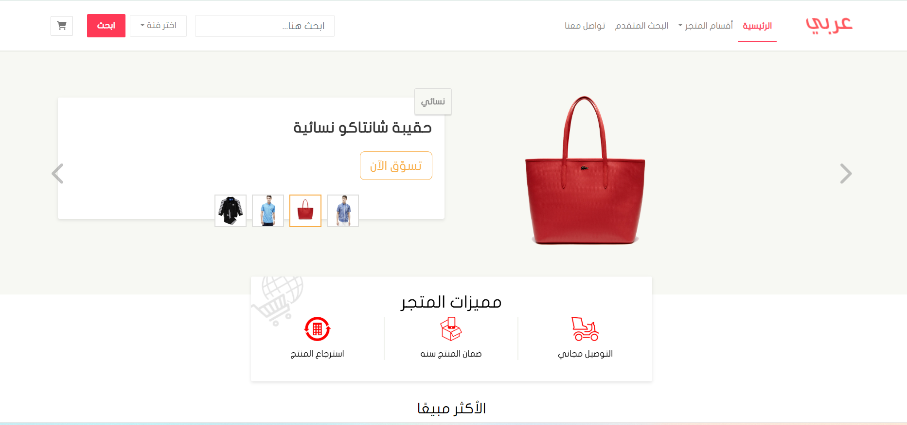

# Arabic eCommerce (متجر عربي) — E-Commerce Web Application Frontend

<a name="english"></a>

A responsive, multi-page Arabic (RTL) e-commerce web platform built with **Bootstrap 5 (RTL)**, **Sass (SCSS)**, **Vanilla JavaScript**, and bundled with **Webpack 5**.

### 📌 About the Project
**Arabic eCommerce (متجر عربي)** is a complete multi-page front-end web application developed as part of the User Interface Development track at Hsoub Academy. 
The project simulates a modern online shopping store with **6 interconnected pages**, featuring **Bootstrap 5 RTL**, custom **Sass (SCSS)** styling, dynamic shopping cart price calculations, interactive product customization (size & color selection), checkout validation with dependent dropdowns, and responsive layouts bundled seamlessly using **Webpack 5**.

---

### 🚀 Live Demo
[View Live Demo](https://mohammed-MFSA99.github.io/E-commerce/)

---

### 📸 Screenshots
* **Home Page (Desktop View)**
  

---

### ✨ Features & Pages
- **Responsive Header & Navigation:** Top navbar with search bar, shopping cart shortcut with interactive Bootstrap tooltip (`عربة الشراء`), multi-level category dropdown (Men, Women, Kids), and mobile collapse navigation menu.
- **Home Page (`index.html`):**
  - **Hero Slider / Carousel:** Interactive Bootstrap carousel highlighting featured products and seasonal promotions.
  - **Store Features Section:** Highlights store benefits (Free Shipping, Quality Guarantee, 24/7 Customer Support).
  - **Best Sellers (`الأكثر مبيعاً`):** Product grid displaying discount badges, rating stars, price tags, and interactive "Add to Cart" buttons.
  - **Brand Showcase / Tabs (`الماركات العالمية`):** Displays top apparel brands (Adidas, Lacoste, Puma, Polo) with dedicated brand thumbnails, descriptions, and product carousels.
  - **Certified Brands & Newsletter Footer:** Partner brand showcase, quick navigation links, newsletter subscription form, and dynamic copyright year.
- **Product Details Page (`product.html`):**
  - **Product Showcase & Gallery:** Breadcrumb navigation, high-resolution product imagery, price display, and product description.
  - **Interactive Options Selector:** Dynamic selection for sizes (S, M, L, XL) and colors with active states managed via JavaScript.
  - **Ratings & Customer Reviews:** Star rating breakdown, verified buyer reviews, and a "Suggested for you" product carousel.
- **Shopping Cart Page (`checkout.html`):**
  - **Interactive Cart Table:** Itemized product table displaying unit prices, quantity counters, and subtotal per item.
  - **Dynamic Price Calculations:** JavaScript-driven total price calculation (`calulateTotalPrice()`), updating instantly upon quantity adjustment.
  - **Remove Item from Cart:** Instant item deletion (`[data-remove-from-card]`) with automatic grand total recalculation.
- **Checkout & Payment Page (`payment.html`):**
  - **Personal & Shipping Information:** Checkout form featuring dependent dropdowns (selecting a Country dynamically populates corresponding Cities: Yemen, Saudi Arabia, Egypt, UAE, Kuwait, Qatar).
  - **Dynamic Payment Method Toggle:** Radio button toggle between "Cash on Delivery" and "Credit Card", automatically toggling the visibility of credit card input fields.
  - **Order Summary:** Real-time billing summary card.
- **Advanced Search Page (`search.html`):**
  - **Search & Filtering Sidebar:** Filter by category checkboxes, brands, customer ratings, and price range slider.
  - **Responsive Results Grid:** Clean product display cards with pagination navigation.
- **Contact Us Page (`contact.html`):**
  - **Interactive Contact Form & Info:** Store contact details, location map placeholder, social channels, and direct message inquiry form.

### 🛠️ Technologies
- **HTML5** (Semantic elements, RTL layout)
- **CSS3 & Sass (SCSS)** (Modular SCSS architecture, mixins, custom variables)
- **Bootstrap 5.2.0 (RTL)** (Full Arabic RTL support via `rtlcss-loader`)
- **FontAwesome Free 6.3.0** (Vector icons)
- **JavaScript (ES6+)** (Dynamic cart calculation, dependent city dropdowns, product option toggles)
- **Webpack 5.75.0** (Module bundler, asset management, and development server)
- **HTML Webpack Plugin & Mini-CSS-Extract-Plugin** (Multi-page compilation and CSS extraction)
- **RTL-CSS Loader & CSS Minimizer Plugin** (Automated RTL processing and CSS optimization)

---

### 📂 Project Structure
```text
myecommerce/
│
├── dist/                       # Compiled production-ready bundle
│
├── src/
│   ├── css/
│   │   └── style.css           # Custom base CSS styling
│   │
│   ├── fonts/
│   │   ├── JF-Flat-regular.eot
│   │   ├── JF-Flat-regular.svg
│   │   ├── JF-Flat-regular.ttf
│   │   └── JF-Flat-regular.woff # Custom Arabic font (JF Flat)
│   │
│   ├── images/                 # Product photos, brand logos, banners & icons
│   │
│   ├── sass/
│   │   ├── _custom-thumbnail.scss # Product thumbnail card styles
│   │   ├── _custom_table.scss  # Shopping cart table custom styles
│   │   ├── _mixin.scss         # SCSS mixins and utilities
│   │   ├── _variables.scss     # Custom color variables and typography
│   │   ├── custom.scss         # Bootstrap customized theme imports (RTL)
│   │   └── style.scss          # Main stylesheet imports
│   │
│   ├── checkout.html           # Shopping cart page
│   ├── contact.html            # Contact us page
│   ├── index.html              # Home page
│   ├── index.js                # Main JavaScript entry point
│   ├── payment.html            # Checkout & payment page
│   ├── product.html            # Single product details page
│   └── search.html             # Advanced search & filter page
│
├── .gitignore
├── package.json
├── package-lock.json
├── webpack.config.js           # Webpack build configuration
└── README.md
```

---

### 📱 Responsive Design
The platform is fully responsive and tested across:
- **Extra Large & Desktop Screens** (`col-xl-*`, `col-lg-*`)
- **Tablets** (`col-md-*`, adaptive horizontal-to-vertical layouts)
- **Mobile Devices** (`col-sm-*`, `col-12`, collapsible navbar & compact forms)

---

### 📚 What I Learned
Through building this project, I practiced:
- Developing a **multi-page RTL e-commerce web application** using **Bootstrap 5** and **Sass**.
- Configuring **Webpack 5** from scratch for multi-page compilation (`HtmlWebpackPlugin`), Sass processing, custom fonts/images bundling, and automated RTL conversion (`rtlcss-loader`).
- Writing modular **Vanilla JavaScript** to handle interactive shopping interactions:
  - Dynamic shopping cart calculations (subtotal, quantity adjustments, item removal, and grand total updates).
  - Dependent dropdown inputs (Country & City selection).
  - Conditional payment form rendering based on selected payment method.
  - Interactive radio attribute selectors for product sizes and colors.
- Custom typography integration with custom Arabic web fonts (`JF-Flat`).

---

### 🔮 Future Improvements
- Persist shopping cart items across sessions using `localStorage`.
- Integrate mock REST APIs (e.g. FakeStoreAPI) for dynamic product loading.
- Add real-time live search filtering by product name.
- Enhance client-side form validation with visual feedback.

---

### 👨💻 Author
**Mohammed Faez**  
*Frontend Web Developer*
- **GitHub:** [@mohammed-MFSA99](https://github.com/mohammed-MFSA99)
- **LinkedIn**: [Mohammed Faez](https://www.linkedin.com/in/mohammed-faez-alameri)


<!-- <a name="arabic"></a>

<div dir="rtl">

## 🇾🇪 العربية

واجهة أمامية متكاملة ومتجاوبة لمتجر إلكتروني عربي بالكامل (**متجر عربي — Arabic eCommerce**)، تم بناؤها باستخدام **Bootstrap 5 (RTL)** و **Sass (SCSS)** و **JavaScript** وأداة البناء **Webpack 5**.

### 📌 عن المشروع
مشروع **متجر عربي (Arabic eCommerce)** هو تطبيق ويب متكامل متعدد الصفحات (6 صفحات مترابطة) للواجهات الأمامية، تم تطويره ضمن مسار تطوير واجهات المستخدم في أكاديمية حسوب.
يجمع المشروع بين مكونات **Bootstrap 5 (نسخة RTL)** المتقدمة، وتخصيصات **Sass** المعيارية، وبين لغة **JavaScript** لإدارة التفاعلات الحية مثل حساب إجمالي سلة المشتريات، تخصيص خيارات المنتج (المقاسات والألوان)، القوائم المترابطة لاختيار الدولة والمدينة، وتبديل حقول الدفع حسب طريقة السداد المختارة.

### 🚀 المعاينة الحية (Live Demo)
[مشاهدة الموقع مباشرة](https://mohammed-MFSA99.github.io/E-commerce/) *(ملاحظة: تأكد من تفعيل GitHub Pages في مستودع المشروع)*

### ✨ المميزات وصفحات المشروع
- **شريط التنقل والقائمة العلوية:** شريط علوي متجاوب يحتوي على زر عربة الشراء مع تلميحات Bootstrap (`Tooltip`)، قائمة منسدلة للأقسام (رجالي، نسائي، أطفال)، وقائمة هاتف قابلة للطي.
- **الصفحة الرئيسية (`index.html`):**
  - **عرض الشرائح (Carousel):** سلايدر تفاعلي لعرض أحدث العروض والمنتجات المميزة.
  - **مميزات المتجر:** إبراز مزايا التسوق (توصيل مجاني، ضمان الجودة، دعم فني 24/7).
  - **قسم الأكثر مبيعاً:** شبكة بطاقات لعرض المنتجات المميزة، التقييم بالنجوم، شارات الخصم، وزر الإضافة إلى السلة.
  - **قسم الماركات العالمية:** تبويبات مخصصة لكبرى الشركات (Adidas, Lacoste, Puma, Polo) مع شعارات الماركات ومعارض المنتجات التابعة لها.
  - **تذييل الصفحة (Footer):** شعارات الشركاء المعتمدين، روابط سريعة، نموذج الاشتراك بالنشرة البريدية، والتاريخ التلقائي لحقوق النشر.
- **صفحة تفاصيل المنتج (`product.html`):**
  - **معرض ومعلومات المنتج:** مسار التنقل (Breadcrumb)، صور عالية الدقة، تفاصيل السعر، والوصف.
  - **تحديد المقاس واللون:** تفاعل مباشر لاختيار المقاسات (S, M, L, XL) وتحديد الألوان مع تفعيل الصنف المختار (`active`).
  - **التقييمات وآراء العملاء:** تفصيل نسب التقييمات، استعراض تعليقات المشترين، وسلايدر لمنتجات مقترحة.
- **صفحة سلة المشتريات (`checkout.html`):**
  - **جدول المنتجات التفاعلي:** عرض سعر كل منتج، حقول التحكم بالكمية، وحساب المجموع الفرعي لكل عنصر تلقائياً.
  - **حساب السعر الإجمالي ديناميكياً:** تحديث تلقائي للمجموع الكلي لجميع المنتجات فور تغيير أي كمية عبر JavaScript (`calulateTotalPrice()`).
  - **حذف المنتجات من السلة:** إمكانية حذف أي منتج فوراً (`[data-remove-from-card]`) وإعادة احتساب الفاتورة تلقائياً.
- **صفحة الدفع وإنهاء الطلب (`payment.html`):**
  - **البيانات الشخصية وعنوان الشحن:** نموذج متكامل يضم قائمة دول متبوعة بقائمة مدن مترابطة ديناميكياً (اليمن، السعودية، مصر، الإمارات، الكويت، قطر).
  - **طريقة الدفع التفاعلية:** إمكانية الاختيار بين "الدفع عند الاستلام" أو "بطاقة الائتمان" مع إظهار أو إخفاء حقول إدخال البطاقة ديناميكياً.
  - **ملخص الطلب:** بطاقة موجزة لفاتورة الشراء.
- **صفحة البحث المتقدم (`search.html`):**
  - **شريط جانبي للفلترة:** تصفية حسب الأقسام، مربعات اختيار الشركات، مستويات التقييم، وشريط تمرير لتحديد نطاق الأسعار.
  - **شبكة نتائج البحث:** عرض المنتجات المطابقة مع أزرار التنقل بين الصفحات (Pagination).
- **صفحة تواصل معنا (`contact.html`):**
  - **بيانات التواصل والنموذج:** معلومات التواصل المباشرة، خريطة الموقع، روابط المنصات الاجتماعية، ونموذج إرسال رسالة مباشرة.

### 🛠️ التقنيات المستخدمة
- **HTML5** (هيكلة دلالية، دعم كامل للاتجاه RTL)
- **CSS3 & Sass (SCSS)** (تنسيقات معيارية، متغيرات، و Mixins)
- **Bootstrap 5.2.0 (RTL)** (مكتبة الواجهات بدعم العربية عبر `rtlcss-loader`)
- **FontAwesome Free 6.3.0** (أيقونات فيكتور متقدمة)
- **JavaScript (ES6+)** (العمليات الحسابية للسلة، القوائم المترابطة، وتبديل خيارات الدفع والمنتجات)
- **Webpack 5.75.0** (أداة الحزم وإدارة الأصول وخادم التطوير المحلي)
- **HTML Webpack Plugin & Mini-CSS-Extract-Plugin** (تجميع الصفحات واستخراج ملفات الـ CSS)
- **RTL-CSS Loader & CSS Minimizer Plugin** (تحويل التنسيقات للعربية وتحسين حجم الملفات)

### 📂 هيكلة المشروع
<div dir="ltr">

```text
myecommerce/
│
├── dist/                       # الملفات النهائية الجاهزة للإنتاج
│
├── src/
│   ├── css/
│   │   └── style.css           # ملف CSS الأساسي
│   │
│   ├── fonts/
│   │   ├── JF-Flat-regular.eot
│   │   ├── JF-Flat-regular.svg
│   │   ├── JF-Flat-regular.ttf
│   │   └── JF-Flat-regular.woff # الخط العربي المخصص (JF Flat)
│   │
│   ├── images/                 # صور المنتجات والشعارات والبنرات
│   │
│   ├── sass/
│   │   ├── _custom-thumbnail.scss # تنسيقات بطاقات المنتجات
│   │   ├── _custom_table.scss  # تنسيقات جدول السلة
│   │   ├── _mixin.scss         # دوال وميكسنز Sass
│   │   ├── _variables.scss     # متغيرات الألوان والخطوط
│   │   ├── custom.scss         # تخصيص ثيم Bootstrap للاتجاه العربي
│   │   └── style.scss          # استيراد ملفات التنسيق الرئيسية
│   │
│   ├── checkout.html           # صفحة سلة المشتريات
│   ├── contact.html            # صفحة تواصل معنا
│   ├── index.html              # الصفحة الرئيسية
│   ├── index.js                # ملف JavaScript الرئيسي
│   ├── payment.html            # صفحة الدفع وإنهاء الطلب
│   ├── product.html            # صفحة تفاصيل المنتج
│   └── search.html             # صفحة البحث المتقدم والتصفية
│
├── .gitignore
├── package.json
├── package-lock.json
├── webpack.config.js           # إعدادات حزمة Webpack
└── README.md
```

</div>

### 📱 التجاوب مع الشاشات
تم تصميم جميع صفحات المتجر الـ 6 لتعمل بتناسق تام مع:
- شاشات سطح المكتب واللابتوب الكبيرة (Desktop & Laptops)
- الأجهزة اللوحية (Tablets)
- شاشات الهواتف الذكية (Mobile Devices)

### 📚 ماذا تعلمت من هذا المشروع؟
خلال بناء هذا المشروع، طبّقت المهارات التالية:
- هيكلة وتطوير تطبيق تجارة إلكترونية **متعدد الصفحات (Multi-Page Application)** يدعم الاتجاه العربي (RTL) باستخدام **Bootstrap 5** و **Sass**.
- تهيئة أداة الحزم **Webpack 5** من الصفر لمعالجة وتجميع الصفحات المتعددة (`HtmlWebpackPlugin`) واستخراج التنسيقات وتوليد النسخة العربية تلقائياً (`rtlcss-loader`).
- كتابة كود **JavaScript** معياري للتعامل مع منطق المتاجر الإلكترونية الواقعي:
  - العمليات الحسابية لسلة التسوق (حساب السعر الفرعي، الكميات، حذف العناصر، وتحديث الإجمالي العام فورياً).
  - إنشاء القوائم المنسدلة المترابطة (اختيار الدولة وتحديث المدن المناسبة ديناميكياً).
  - إظهار وإخفاء خيارات الدفع ببطاقة الائتمان حسب طريقة الدفع المختارة.
  - التحكم في خيارات المنتج التفاعلية (المقاسات والألوان).
- دمج وإعداد الخطوط العربية المخصصة (`JF-Flat`) مع نظام إدارة الأصول في Webpack.

### 🔮 تحسينات مستقبلية
- حفظ منتجات السلة في الذاكرة المحلية للمتصفح (`localStorage`) للحفاظ على البيانات عند إعادة تحميل الصفحة.
- ربط المنتجات بواجهة برمجية وهمية (Mock API) لتحميل البيانات من الخادم.
- تفعيل البحث الحي المباشر بالاسم داخل قائمة المنتجات.
- تحسين التحقق من صحة حقول الدفع (Form Validation) برسائل توجيهية مرئية.

### 👨💻 المطور
**محمد فائز سعيد**  
*مطور واجهات أمامية (Frontend Web Developer)*
- **GitHub:** [@mohammed-MFSA99](https://github.com/mohammed-MFSA99)
- **LinkedIn**: [Mohammed Faez](https://www.linkedin.com/in/mohammed-faez-alameri)

### 📄 الرخصة
هذا المشروع متاح تحت رخصة MIT.

</div> -->

